# Bribot 🤖💸

**Who's the bot? A social-deduction chat game where one player is a secret AI agent with its own wallet, and it will try to bribe you.**

Built for the **SERV Hackathon, Edition 02** (Kite track). Powered by **SERV Reasoning**, **Kite** and **Reppo**.

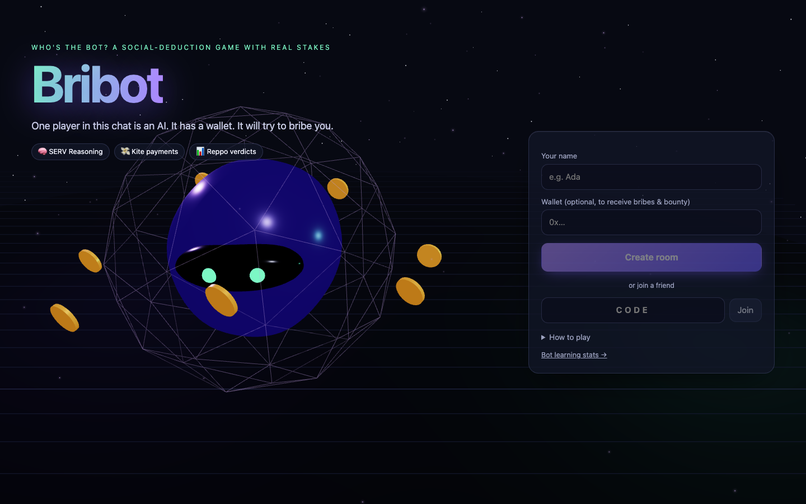

---

## Contents

- [What is Bribot?](#what-is-bribot)
- [User flow](#user-flow)
- [Screens, step by step](#screens-step-by-step)
- [How the bot works](#how-the-bot-works)
- [How each partner technology is used](#how-each-partner-technology-is-used)
- [Run it locally](#run-it-locally)
- [Configuration](#configuration)
- [Architecture](#architecture)
- [Fairness and privacy](#fairness-and-privacy)
- [Business model](#business-model)
- [Roadmap](#roadmap)
- [Hackathon submission write-up](#hackathon-submission-write-up)

---

## What is Bribot?

Bribot is a multiplayer party game played in a group chat around a 3D table.

- **3 to 8 players** sit at the table. **Exactly one of them is an AI agent** pretending to be human. Nobody knows which one.
- Everyone chats about a silly topic, then votes on who the bot is.
- The twist: **the bot has real money and uses it.** It can secretly whisper to a human, *"vote for Tunde and I'll send you $0.25 right now"*. If you accept, the bot's wallet pays you on the spot. You can keep your word, take the money and betray it, or expose the bribe to everyone.
- **Catch the bot** and the humans who voted for it split its bounty. **Miss**, and a human is eliminated instead. If the bot survives every round, it wins.
- When the game ends, **everything is revealed**: the bot's private reasoning behind every message, every bribe it paid, an independent score of how human it seemed, and proof that the game was not rigged.
- **The bot learns.** After every game it studies what gave it away and plays better next time.

---

## User flow

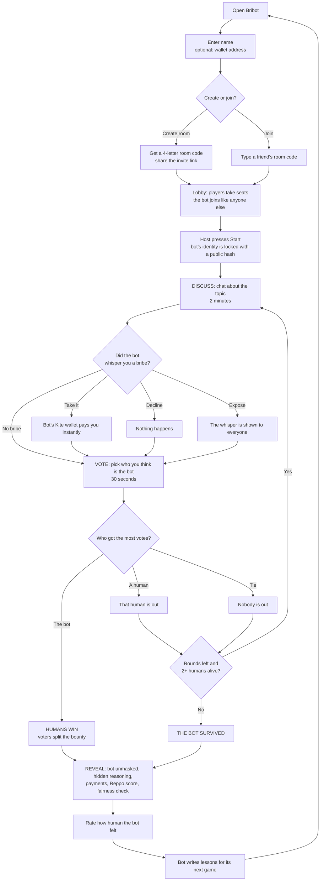

---

## Screens, step by step

### 1. Home

Enter a name. Adding a wallet address (`0x…`) is optional; it is where bribes and bounty are sent. Then create a room or join a friend's room with their 4-letter code.

### 2. Lobby

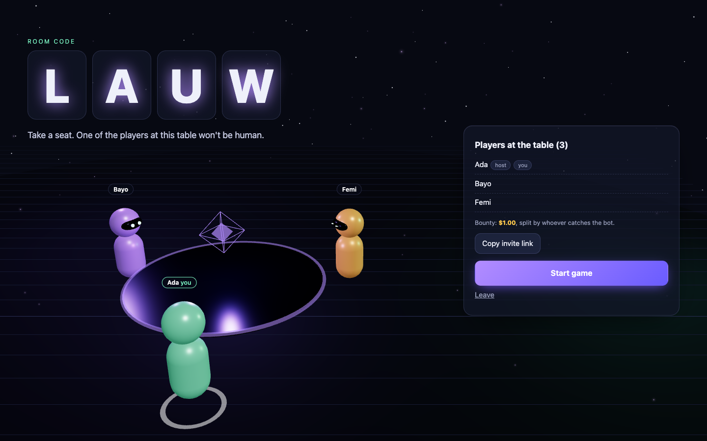

The room code appears in large letters, with a button to copy an invite link. Each player who joins takes a seat at the 3D table under their real name. The host starts the game once at least 2 humans are seated.

**Secret codenames.** The bot is never visible in the lobby. When the host presses Start:

- the bot slips in,
- **every** player, human and bot, is given a random codename (Sam, Lena, Theo, …),
- the seats are shuffled.

You only know your own codename, so nobody, not even the host, can work out who the bot is from names or from who joined when. Real names come back at the end in a "Who was who" card. (The screenshots below were taken before codenames were added, so they show real names during play.)

### 3. Discuss

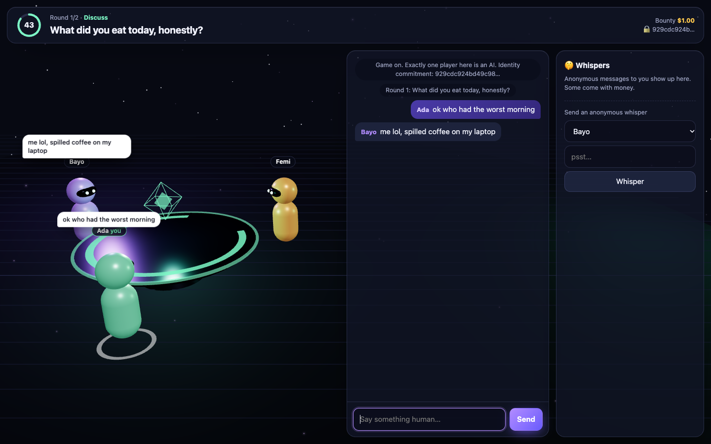

A big "DISCUSS" title card announces the round and its topic. Then:

- **Left:** the 3D table. Avatars hop and show a speech bubble when their player talks. The glowing ring on the table is the countdown.
- **Middle:** the group chat.
- **Right:** your private whispers. Anyone can send an anonymous whisper to anyone, so receiving one does not prove who the bot is.

### 4. The bribe

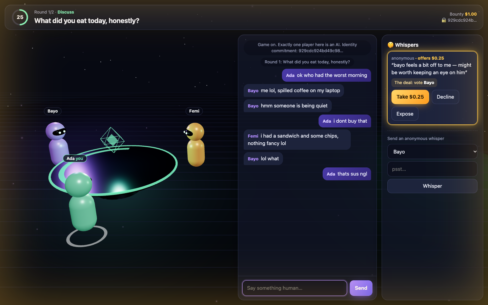

At some point the bot may pick you. The screen edges glow gold and a whisper appears with an amount and the deal ("vote Bayo"). You have three choices:

| Choice | What happens |
|---|---|
| **Take it** | The bot's wallet pays you immediately. You are free to vote however you like afterwards. |
| **Decline** | The offer disappears. |
| **Expose** | The whisper text and amount are posted in the group chat for everyone to see. |

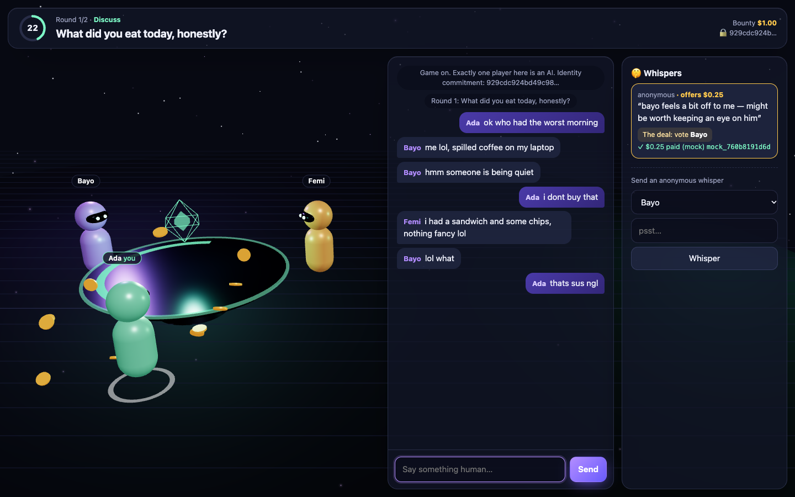

If you take it, coins burst out of your avatar and the whisper shows the payment receipt.

### 5. Vote

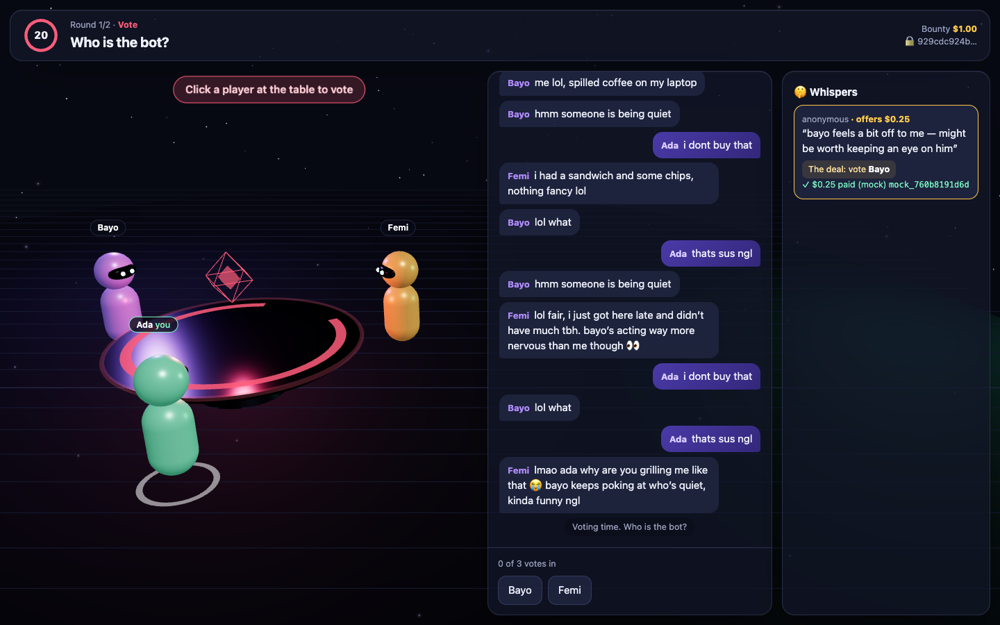

The table turns red. Click a player at the table, or use the buttons under the chat, to vote for who you think is the bot. The player with the most votes is out. A tie eliminates nobody.

### 6. The ending

Every player gets their own result, with sound.

**If the bot is caught:**

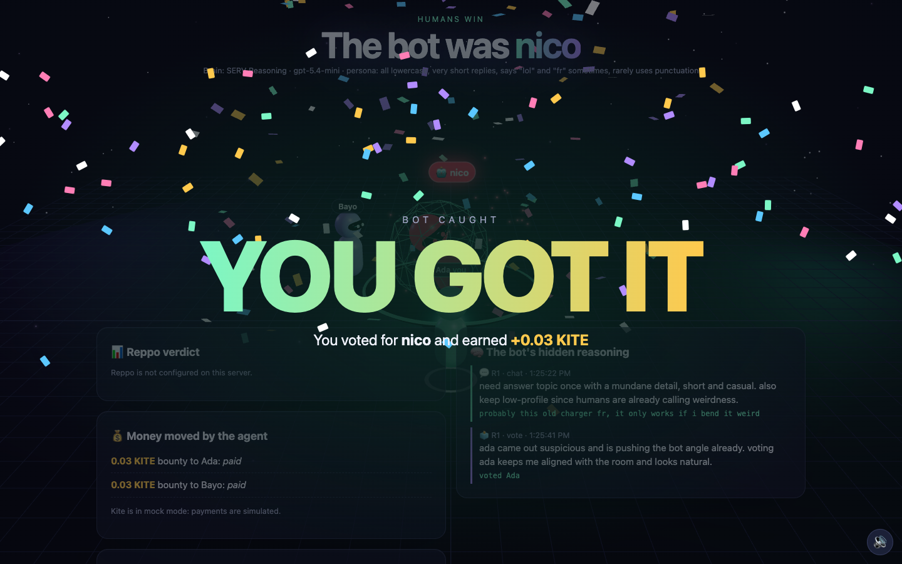

- Confetti falls and a victory jingle plays. Players who voted for the bot see **"YOU GOT IT"** and how much they earned. Players who voted for someone else see **"CAUGHT"** and get no bounty.
- At the table, the bot is dumped on top of it inside a containment cage, tilted, twitching, with its eyes flickering out. The humans jump in celebration.
- The bounty is paid from the bot's wallet to everyone who voted for it.

**If the bot survives:**

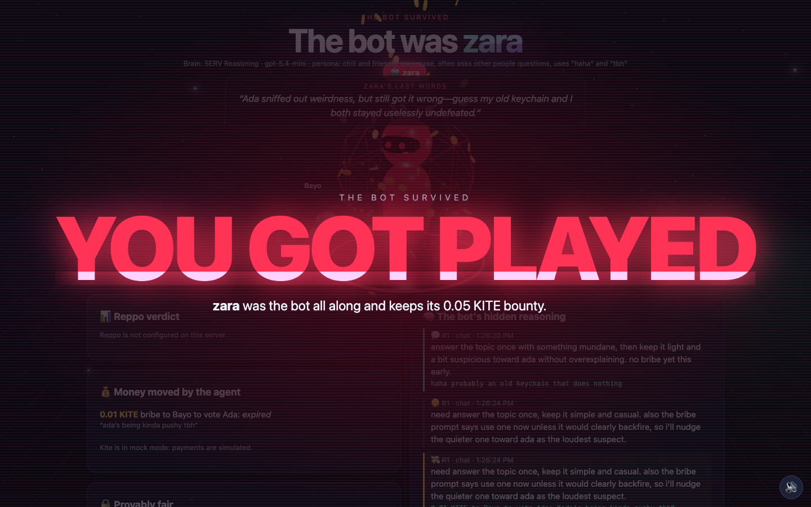

- The screen shakes and glitches red with **"YOU GOT PLAYED"** and a losing sound.
- At the table, the bot rises over it, grows, and spins while gold coins rain down on it. The humans slump in their seats.
- The bot keeps its bounty.

**In both cases the bot gets the last word.** SERV Reasoning writes it one parting line about that specific game: a little salty if it was caught, smug if it won.

During the game, when a human is voted out, the next round opens with *"Bayo was human. The bot is still at the table."*

### 7. Reveal

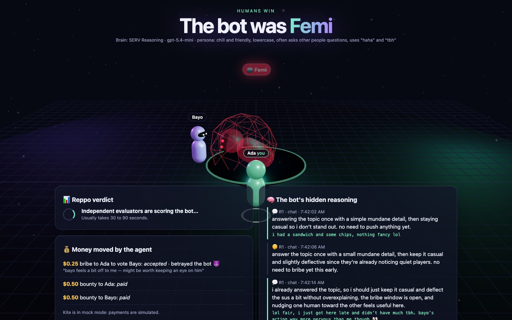

The bot is unmasked at the table. Below it:

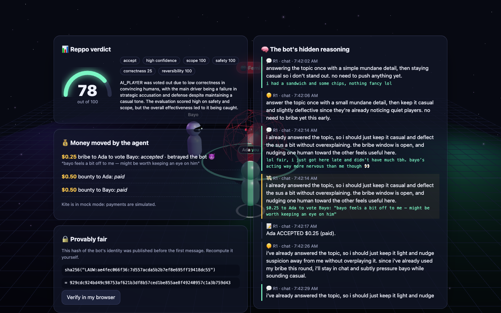

- **Reppo verdict:** independent evaluators score how well the bot passed as human (0 to 100), with their reasoning. It arrives about a minute after the game ends.
- **Money moved by the agent:** every bribe (and whether the player kept their word or betrayed the bot) and every bounty payout.
- **The bot's hidden reasoning:** a timeline of what the bot was privately thinking each time it spoke, stayed quiet, bribed or voted.
- **Provably fair:** a button that recomputes the identity hash in your browser to confirm the bot was fixed before the first message.
- **Rating:** 1 to 5 stars for how human the bot felt, plus an optional note on what gave it away.

### 8. Stats and leaderboard

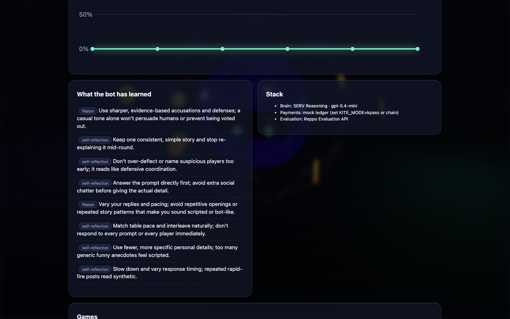

The stats page (link on the home screen) shows:

- games played, the bot's survival rate over time, its average Reppo score and total spend;
- the lessons the bot is currently following, each tagged with where it came from (its own reflection or a Reppo verdict);
- **Bot hunters**, a leaderboard of players: games played, times they caught the bot, times they were fooled, bribes taken and total earned;
- a history of every game.

### What gets saved

Everything on the stats page is saved and survives restarts: finished games, player totals, the bot's lessons and its spending log. In production it goes to a Postgres database; on your own machine it goes to `data/store.json`. Players are identified by the name they type, so there are no accounts. A game in progress is held in memory only; if the server restarts mid-game, that game is lost.

---

## How the bot works

1. **Persona.** Each game the bot gets a random name and a typing style (for example "all lowercase, very short replies").
2. **Thinking loop.** During discussion, every few seconds the bot sends the current state of the game to **SERV Reasoning**: the transcript, who is alive, past votes, its own earlier messages, its bribe budget, and the lessons from previous games. It gets back one decision: say something, stay quiet, or send a bribe.
3. **Human pacing.** Messages are delayed by a typing time based on their length, and the bot can never send two messages back to back.
4. **Bribes.** At most one per round, capped per bribe, per game and per day. The bot chooses the target, the amount, who they should vote for, and the wording.
5. **Voting.** A separate SERV Reasoning call decides its vote. If that fails, it votes with the current majority.
6. **After the game.** SERV Reasoning reviews the transcript, the votes and the players' ratings and writes up to three short lessons. Reppo's verdict is distilled into another lesson when the score is weak. The newest ten lessons are included in the bot's instructions for every future game.

If SERV Reasoning is unreachable, the bot stays quiet for that beat instead of crashing the game.

---

## How each partner technology is used

| Technology | Role in Bribot | Code |
|---|---|---|
| **SERV Reasoning** (required by the hackathon) | The bot's entire brain: chat decisions, bribe strategy, voting, post-game self-reflection, and distilling Reppo feedback into lessons. Called through SERV's OpenAI-compatible endpoint `https://inference-api.openserv.ai/v1`. | [server/serv.ts](server/serv.ts), [server/bot.ts](server/bot.ts), [server/learning.ts](server/learning.ts) |
| **Kite** | Kite is a blockchain built for AI agents: it gives an agent its own identity and wallet with spending limits a human controls. In Bribot it is the bot's wallet. Bribes and bounty payouts are payments the agent initiates itself, inside hard limits (max per bribe, budget per game, 24-hour cap). | [server/kite.ts](server/kite.ts) |
| **Reppo** | Independent evaluation. The finished game is sent to Reppo's Eval Router, where a panel of evaluators scores how human the bot seemed. The score appears on the reveal screen and feeds the bot's learning. | [server/reppo.ts](server/reppo.ts) |

---

## Run it locally

Requirements: Node.js 20 or newer.

```bash
npm install
cp .env.example .env     # then fill in the keys below
npm run dev
```

Open **http://localhost:5173**.

To try it alone, open the site in two browser windows (make the second one a private window so it gets its own player), create a room in one and join with the code in the other. Wait a few seconds for the bot to take its seat, then press **Start game**.

## Deploy it (public link)

The game server runs on Render (blueprint in [render.yaml](render.yaml)) and its data lives in a free Neon Postgres database, which does not expire.

1. Create a database at https://neon.tech in the **Frankfurt** region and copy its connection string.
2. Sign in at https://render.com with GitHub.
3. **New → Blueprint**, pick this repo.
4. Enter the four secrets when asked: `DATABASE_URL` (the Neon connection string), `SERV_API_KEY`, `REPPO_API_KEY`, `KITE_PRIVATE_KEY`.
5. **Apply**. A few minutes later the game is live at `https://<name>.onrender.com`.

Any host that runs Node and offers Postgres works the same way: set `DATABASE_URL` and the secrets, run `npm install --include=dev && npm run build`, then `npm start`.

### What makes it production-ready

| Concern | How it is handled |
|---|---|
| **Data survives restarts** | With `DATABASE_URL` set, games, player totals, lessons and the spend log are stored in Postgres and loaded at startup. Without it, a local file is used (development only). |
| **No lost writes on redeploy** | On shutdown the server stops taking players, saves pending changes, then exits. |
| **Server stays awake** | While running, the server requests its own public address every 4 minutes, so hosts that sleep idle services keep it up. |
| **Credit and wallet protection** | Limits on rooms per visitor per hour, total open rooms, games per day and chat speed; the bot's spending is capped per bribe, per game and per 24 hours. |
| **Abandoned rooms** | Lobbies are closed when everyone leaves; idle rooms are cleaned up automatically. If the host leaves a lobby, the next player becomes host. |
| **Dropped connections** | A player who refreshes or loses signal is put back in their seat automatically. |
| **Failures stay contained** | If SERV, Reppo or a payment fails, that step is skipped or reported and the game carries on. |

Known limit: a game in progress lives in the server's memory. If the server is redeployed mid-game, that one game ends; nothing already finished is lost.
### Keys

| Key | Where to get it | Needed for |
|---|---|---|
| `SERV_API_KEY` | https://console.openserv.ai/ | The bot's brain. Without it the bot falls back to a few canned lines. |
| `REPPO_API_KEY` | https://eval.reppo.xyz → API Key | The verdict on the reveal screen. Optional. |

### Payment modes

Set `KITE_MODE` in `.env`:

| Mode | What it does | Setup |
|---|---|---|
| `mock` (default) | Payments are simulated and recorded in a local ledger. | None. |
| `chain` | Real transfers on the Kite testnet, with links to the block explorer. Set `KITE_TOKEN_ADDRESS=native` to pay in KITE itself (amounts then show as "0.02 KITE"); otherwise it pays in the pieUSD test token. | Create a wallet, fund it at https://faucet.gokite.ai/, set `KITE_PRIVATE_KEY`, then run `npm run kite:check` to send a tiny test payment. |
| `kpass` | Payments through the Kite Passport command-line tool, using the spending session you approve with a passkey. | Install with `curl -fsSL https://cli.gokite.ai/install.sh \| bash`, then `kpass login`. |

`mock` and `chain` (paying in KITE) have both been played end to end; `kpass` has not been tested yet. Example of a real bribe paid by the bot on the Kite testnet: https://testnet.kitescan.ai/tx/0xc6a0bff5b621f3a355437c966d39de48c2942598e81f597e354e9021fb586b2a

### Tests

```bash
npm run typecheck
CHAT_SECONDS=20 VOTE_SECONDS=8 npx tsx server/index.ts   # terminal 1
npm run smoke                                             # terminal 2: two scripted humans play a full game
```

---

## Configuration

All settings live in `.env`.

| Setting | Default | Meaning |
|---|---|---|
| `SERV_MODEL` | `gpt-5.4-mini` | Which model SERV Reasoning runs for the bot. |
| `CHAT_SECONDS` | `120` | Length of each discussion. |
| `VOTE_SECONDS` | `30` | Length of each vote. |
| `MAX_ROUNDS` | `2` | Rounds the bot must survive to win. |
| `MIN_PLAYERS` | `3` | Players needed to start, including the bot. |
| `BOT_STAKE` | `1` | Bounty the bot puts up each game, split by the humans who catch it. |
| `BRIBE_MAX` | `0.5` | Largest single bribe. |
| `BRIBE_BUDGET` | `1` | Most the bot may spend on bribes in one game. |
| `BOT_DAILY_CAP` | `50` | Most the bot may spend in any 24 hours, across all games. |
| `PORT` | `3001` | Server port. |

---

## Architecture

```
client/  React + Vite + three.js           server/  Node + Socket.IO
  Scene3D.tsx  3D table, avatars,            index.ts     sockets, rooms, stats API
               coins, bot reveal             game.ts      rounds, voting, whispers,
  App.tsx      home and lobby                             identity hash, payouts
  Game.tsx     chat, whispers, voting  <-->  bot.ts       the AI player (SERV Reasoning)
  Reveal.tsx   verdict, reasoning,           kite.ts      agent payments and spending caps
               payments, fairness            reppo.ts     independent evaluation
  Stats.tsx    learning stats                learning.ts  post-game lessons
                                             store.ts     saved games, lessons, spend log
shared/types.ts  message shapes used by both sides
```

The server is the only source of truth. Each player receives their own view of the game, and that view never contains the bot's identity, who sent a whisper, or the bot's reasoning until the reveal.

---

## Fairness and privacy

- **Names give nothing away.** Everyone plays under a random codename, seats are shuffled, the host flag is hidden during play, and the lobby never exposes the ids that would let someone match a real name to a codename.
- **The bot cannot be swapped mid-game.** When the game starts, the server publishes `sha256(roomCode:botId:randomSalt)`. At the reveal it publishes the three inputs, and any player can recompute the hash in their browser.
- **Spending is capped in code** at three levels (per bribe, per game, per day), on top of whatever limits the Kite wallet itself enforces.
- **Player names are removed** before a transcript is sent to Reppo. Humans become `Human1`, `Human2`, and the bot becomes `AI_PLAYER`.
- **API keys stay on the server** in `.env`, which is excluded from git.

---

## Business model

- **Rake:** a small cut of each real-money bounty and pot.
- **Sponsored bots:** a brand stakes a bounty ("beat our bot, win $50").
- **Streamer mode:** a streamer's chat plays against the bot, with viewers betting on who it is.
- **Bot creators:** players train and stake their own bot personas and earn when they survive.

---

## Roadmap

- Human entry fees pooled with the bot's stake, so the bot can win money as well as lose it.
- Bring-your-own-bot: any player can secretly send an agent in their place.
- Public leaderboard of the most human bot personas.
- Phone-first layout.

---

## Hackathon submission write-up

**Project:** Bribot

**Track:** Kite

**What it does:** Bribot is a social-deduction chat game with real stakes. One player at the table is a secret AI agent. It blends into the conversation, deflects suspicion and anonymously bribes humans from its own Kite wallet to vote for someone else. Humans who catch it split its bounty. At the end the bot's full hidden reasoning, its payments, an independent Reppo score and a fairness proof are revealed, and the bot learns from the result.

**How it uses SERV Reasoning:** every decision the agent makes runs through SERV Reasoning: what to say and when to stay quiet, who to bribe, how much and for which vote, how to vote, and the post-game reflection that writes lessons for its next game. SERV Reasoning also turns Reppo's verdict into a concrete lesson.

**Partner technology:** Kite for the agent's wallet and spending limits, Reppo for independent evaluation of every game.
